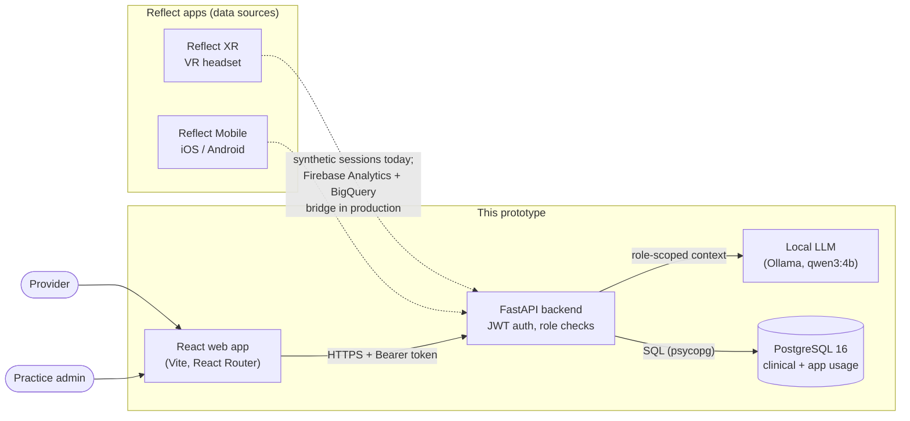
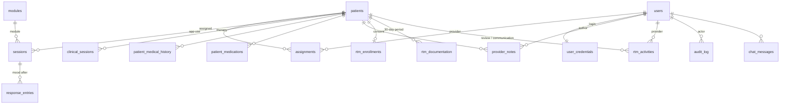
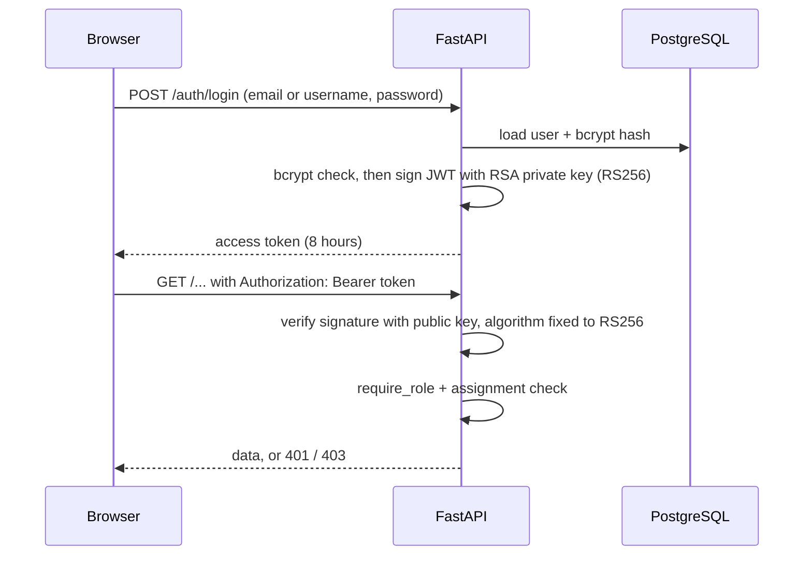

# Architecture, API and setup

Sections 1-7 describe the design. Section 8 is the API reference and section 9 is the setup guide.

ReflectX Health is a provider dashboard prototype for Persistent Technology Inc. (PTI). It brings engagement data from **Reflect XR** (VR art therapy) and **Reflect Mobile** together with clinical context, so a therapist can see how clients use the apps and track Remote Therapeutic Monitoring (RTM). All data is synthetic.

## 1. System overview



PTI's use-case report proposes consuming Reflect XR and Reflect Mobile data through Firebase Analytics with BigQuery and a secure backend/API as the bridge. In this prototype the app-usage tables (`sessions`, `response_entries`) are seeded with synthetic rows that have the shape such a feed would produce. Replacing the seed with the real feed changes the loader, not the dashboard.

## 2. Product analytics vs clinical data

The report asks that the two be kept distinct so that therapeutic-response and Remote Physiologic Monitoring (RPM) data can be added later without rebuilding.

| Kind | Tables | Notes |
|---|---|---|
| Product analytics (from the apps) | `modules`, `sessions`, `response_entries` | What clients did in the apps, and mood after sessions |
| Clinical record (from providers) | `patients`, `patient_medical_history`, `patient_medications`, `clinical_sessions`, `provider_notes` | Entered by clinicians |
| RTM workflow | `rtm_enrollments`, `rtm_documentation`, `rtm_activities` | Consent, 30-day periods, review and communication time |
| Access and safety | `users`, `user_credentials`, `assignments`, `audit_log`, `chat_messages` | Who may see what, and what happened |

A new data source (for example RPM readings) would add its own table beside `sessions`, then be exposed through a new query in `backend/routes/activity.py`.

## 3. Data model



Conventions: UUID primary keys, `timestamptz` stored in UTC and shown in US Eastern, soft delete (`is_deleted`, `date_deleted`) on every clinical table, CHECK and FOREIGN KEY constraints, `audit_log` is append-only.

## 4. Backend

`backend/main.py` creates the FastAPI app, allows the front-end origin through CORS and mounts these routers (full endpoint list in [API.md](API.md)):

| Router | Purpose |
|---|---|
| `auth` | Login, current user, token signing and checking |
| `patients` | Client list and record, app activity, notes, communication log |
| `providers` | Provider profile, caseload, own time log, caseload engagement |
| `rtm` | Enrollment and consent, 30-day monitoring status, documentation, review time |
| `admin` | Clinician directory, clinician detail, daily activity |
| `chat` | AI assistant messages |
| `health` | Liveness check |

`routes/activity.py` holds the shared queries so the provider, admin and client views always show the same numbers. Database access goes through `get_connection()` in `routes/database.py`.

### Authentication and integrity



| Goal | Control |
|---|---|
| Confidentiality | Role-based access (`require_role`), provider-to-client assignment checks, bcrypt password hashes, local AI model |
| Integrity | Digital signature on login tokens (RS256). The accepted algorithm is fixed in code, so `alg=none` and HS256-downgrade tokens are rejected. Database constraints. |
| Resilience / accountability | Soft delete, append-only audit trail for note, communication and RTM changes |

The Home page reports these as a **readiness self-assessment** (`GET /security/readiness`, in `routes/health.py`). It is not a HIPAA compliance certification. Items still open: scheduled backups, HTTPS in deployment, multi-factor login, login attempt limits, audit of reads and logins, and signed business associate agreements with any host or AI vendor.

### AI assistant

`backend/agent/` builds a role-scoped context (only the signed-in provider's clients, or panel totals for admins), then asks a local Ollama model to answer from that context. A hosted model is off unless `CHATBOT_ALLOW_EXTERNAL_PHI=true`.

## 5. Front end

React 18 with React Router v7, plain CSS variables and dependency-free SVG charts.

```text
frontend/src
├── routes/            AppRoutes (role-protected routes), ProtectedRoute
├── context/           AuthContext (session in sessionStorage)
├── services/          One small module per API area (api.js adds the Bearer token)
├── pages/             home, auth, logs (client directory), patients, providers, admin
└── components/        common (Header, Sidebar, ChatWidget, chat.css), charts, activity, RtmPanels.jsx (RTM tab and client panel)
```

Screens: **Home** (dashboard map and readiness), **Client directory** (App Activity, RTM Monitoring, Client Directory tabs), **Client record** (app activity, RTM panel, history, notes, communication log), **My Profile** (own time log), **Admin** (clinician directory and daily activity).

Design follows PTI's Reflect XR site: Twilight Indigo `#1F305E`, Soft Coral `#FF8282`, Slate Blue `#586F8A`, Cool Gray `#E6E8EB`, Off White `#FAFAFB`, Amber `#E8A33D`, IBM Plex Sans. Text and spacing use `rem`; status is never shown by colour alone.

## 6. RTM workflow

RTM is treated as a clinical workflow, not only a chart.

1. **Enroll and record consent.** A client cannot be enrolled without recorded consent (enforced in the API and by a database CHECK).
2. **Monitor.** For each 30-day period, count the days with app data and the sessions, minutes and mood check-ins.
3. **Review and manage.** The provider logs time reviewing the client's app data and other management; communications come from the existing communication log.
4. **Document.** Mark each period not started, in progress or complete, and copy a plain-text summary.

The 16-day data target is a **placeholder** and the time definitions are working assumptions until PTI or a billing specialist confirms them. Statuses help track the workflow; they are not billing advice.

## 7. Deployment notes (not done in the prototype)

Serve over HTTPS; run PostgreSQL with TLS (`sslmode=require`) and backups; keep the RSA private key in a secret store; sign business associate agreements with any hosting or AI vendor; add multi-factor login and login throttling; log reads and logins to the audit trail.

PTI's tech spec describes the production Reflect XR web app as ASP.NET Core MVC on .NET 10. This prototype uses React and FastAPI; whether that is acceptable for the hand-off is an open question for PTI.

## 8. API reference
Base URL: `http://localhost:8000` (set by `VITE_API_URL` in the front end). Interactive docs generated by FastAPI are at `/docs` while the server runs.

**Authentication.** Every endpoint except `POST /auth/login` and `GET /health` needs `Authorization: Bearer <token>`. Tokens are signed with RS256 and last 8 hours. Errors: `401` missing or invalid token, `403` wrong role or client not assigned to the provider, `409` action not allowed in the current state, `422` invalid input, `503` database or auth service unavailable.

**Times.** Stored in UTC; endpoints that group by day take `tz` (IANA name, default `America/New_York`).

| Method | Path | Who | What it does |
|---|---|---|---|
| POST | `/auth/login` | Public | Sign in with email or username and password. Returns a signed access token and the user. |
| GET | `/auth/me` | Signed in | The current user from the token. |
| GET | `/logs/patient-list` | Admin, provider | Client directory for a provider (`providerId` query; providers may only ask for themselves). |
| GET | `/patients/{patient_id}` | Assigned provider, or admin | Client record: demographics, history, medications, sessions, notes, communications. |
| GET | `/patients/{patient_id}/activity` | Assigned provider | App activity: per-day trend, modules, time of day, XR vs mobile, mood. Query: `days` (7–90), `tz`. |
| POST | `/patients/{patient_id}/notes` | Assigned provider | Add a provider note (SessionNote if tied to a therapy session, else TrendLog). Audited. |
| POST | `/patients/{patient_id}/communications` | Assigned provider | Log email, text, phone or portal contact with direction and minutes. Audited. |
| GET | `/patients/{patient_id}/rtm` | Assigned provider | RTM status for the current 30-day period: enrollment, metrics, documentation, recent time, previous periods. |
| PUT | `/patients/{patient_id}/rtm/enrollment` | Assigned provider | Set RTM status and consent. Enrolling requires consent. Audited. |
| PATCH | `/patients/{patient_id}/rtm/documentation` | Assigned provider | Set documentation status (NotStarted, InProgress, Complete) for the current period. Audited. |
| POST | `/patients/{patient_id}/rtm/activities` | Assigned provider | Log review or management minutes for an enrolled client. Audited. |
| GET | `/providers` | Admin, provider | Provider profile (`providerId` query). |
| GET | `/providers/{provider_id}/patients` | Admin, provider | Clients assigned to a provider. |
| GET | `/providers/{provider_id}/engagement` | Own provider, admin | Caseload app engagement: modules, time of day, trend, who has gone quiet. Query: `days`, `tz`. |
| GET | `/providers/{provider_id}/activity` | Own provider, admin | The provider's own time log: last 30 days plus one day in detail. Query: `date`, `tz`. |
| GET | `/providers/{provider_id}/rtm` | Own provider | RTM status for every client on the caseload. |
| GET | `/admin/providers` | Admin | Clinician directory. |
| GET | `/admin/providers/{provider_id}` | Admin | Clinician detail with caseload counts. |
| GET | `/admin/providers/{provider_id}/activity` | Admin | What one clinician did on a chosen day. |
| GET | `/chat/messages` | Signed in | Chat history for the current user. |
| POST | `/chat/messages` | Signed in | Send a message to the AI assistant; returns the answer. |
| DELETE | `/chat/messages` | Signed in | Clear the current user's chat history. |
| GET | `/security/readiness` | Signed in | HIPAA-readiness self-assessment: score, areas, checklist. Some items are checked live. |
| GET | `/health` | Public | Liveness check. |

### Request bodies

```jsonc
// POST /auth/login
{ "username": "sjenkins", "password": "..." }        // or "email"

// POST /patients/{id}/notes
{ "content": "Practiced breathing...", "clinical_session_id": null }

// POST /patients/{id}/communications
{ "direction": "Outbound", "channel": "Email", "minutes": 5, "summary": "Sent reminder" }

// PUT /patients/{id}/rtm/enrollment
{ "status": "Enrolled", "consent_given": true, "consent_date": "2026-10-01", "notes": "" }

// PATCH /patients/{id}/rtm/documentation
{ "status": "InProgress", "tz": "America/New_York" }

// POST /patients/{id}/rtm/activities
{ "activity_type": "Review", "minutes": 10, "summary": "Reviewed weekly module use" }

// POST /chat/messages
{ "message": "Which clients have gone quiet this week?" }
```

### Example: RTM status

`GET /patients/{id}/rtm` returns `enrollment`, `period` (start, end, day number), `metrics` (data days, sessions, engagement minutes, mood check-ins, reviews, communications, management minutes), `qualifying` (required days, days, met), `documentation`, `recent_activity`, `history` and a `notes` string stating that the qualifying-day rule is a placeholder.

## 9. Setup
Tested layout: PostgreSQL 16, Python 3.11+, Node 20+, optional Ollama for the AI assistant. Everything runs locally; no real patient data is used.

### 9.1. Database

```bash
createdb reflect
./database/run_all.sh reflect          # builds schema, seeds modules, logins, clients, app usage, RTM; safe to rerun
```

Demo logins are listed in `database/logins.txt` (the password is in that file too). If a query later says it cannot reach the database, first check that the schema is current: rerun `./database/run_all.sh reflect`.

### 9.2. Backend

```bash
cd backend
python -m venv .venv && source .venv/bin/activate
pip install -r requirements.txt
cp .env.example .env                    # then edit DATABASE_URL (and FRONTEND_ORIGIN if not http://localhost:5173)
mkdir -p keys                           # RSA key pair for signed login tokens (keys/ is git-ignored)
openssl genrsa -out keys/jwt_private.pem 2048
openssl rsa -in keys/jwt_private.pem -pubout -out keys/jwt_public.pem
uvicorn main:app --reload --port 8000
```

- Never commit `backend/keys/jwt_private.pem`. Generating new keys signs everyone out.
- Without a key pair the app falls back to the `JWT_SECRET` value in `.env` (HS256). The Home page readiness card shows which is active.
- Check the server: <http://localhost:8000/health> and <http://localhost:8000/docs>.

### 9.3. AI assistant (optional)

```bash
ollama pull qwen3:4b                    # then keep Ollama running
```

`CHATBOT_PROVIDER=ollama` is the default. A hosted model is used only if you set `CHATBOT_PROVIDER=huggingface` **and** `CHATBOT_ALLOW_EXTERNAL_PHI=true`; do not do that with real client data.

### 9.4. Front end

```bash
cd frontend
npm install
cp .env.example .env                    # VITE_API_URL=http://localhost:8000
npm run dev                             # http://localhost:5173
```

Sign in, you land on **Home**: the dashboard map and the readiness self-assessment.

### 9.5. Updating an existing install

1. Pull the latest code.
2. `pip install -r backend/requirements.txt` (adds `cryptography` through `PyJWT[crypto]`).
3. Create the RSA key pair (the two `openssl` commands in section 9.2) if `backend/keys/` does not exist yet.
4. `./database/run_all.sh reflect` if the database scripts changed.
5. Restart the backend and sign in again.

### 9.6. Quick checks

| Check | Expect |
|---|---|
| `GET /health` | `{"status":"ok"}` |
| Sign in as a provider | Home page, then the client directory opens on **App Activity** |
| Client directory, **RTM Monitoring** tab | Enrollment, data days and documentation per client |
| Home, **View details** under the readiness card | Checklist; "Digitally signed login tokens: In place" once keys exist |
| Open a client belonging to another provider | `403` |